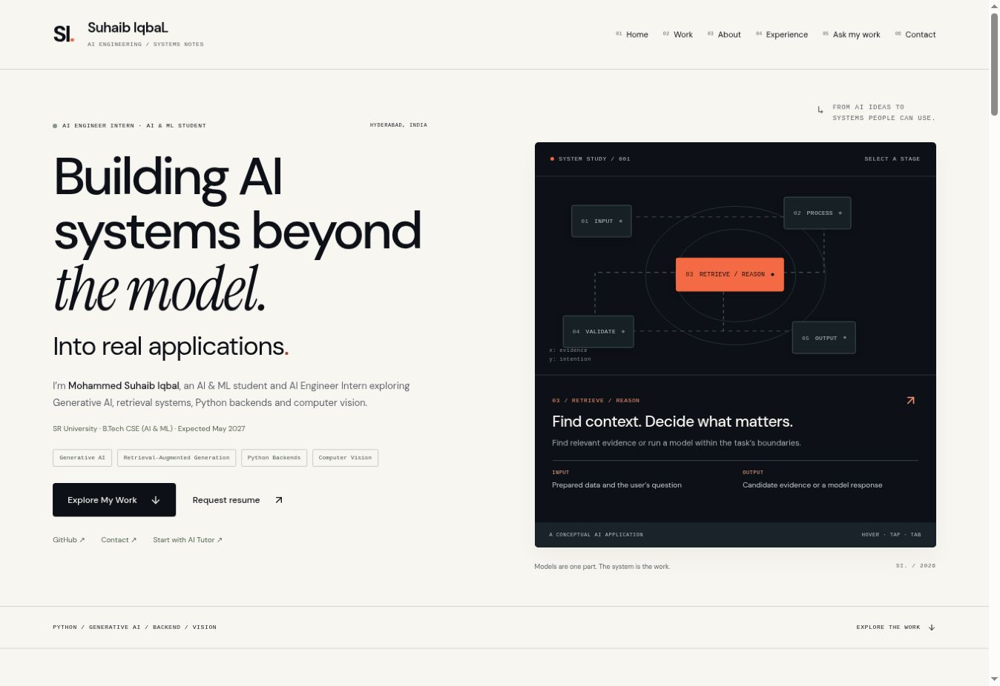

# Suhaib IqbaL — AI Engineer Portfolio



Version 2 of Mohammed Suhaib Iqbal’s personal AI engineering portfolio. Exact wordmark: **Suhaib IqbaL**. Monogram: **SI.**

## Run

Node.js 22+ and npm. From the `suhaib-portfolio/` directory:

```bash
npm ci
npm run dev
```

Open http://localhost:3000.

```bash
npm run lint
npm run typecheck
npm test
npm run build
```

Next.js App Router, strict TypeScript, React, Lucide, self-hosted DM Sans / Instrument Serif and custom CSS. Retains the existing application architecture and compatible package versions. No runtime database, paid service or API key is needed.

## Included

- Personal brand, editorial hero, education/status and six-destination navigation.
- Keyboard/tap/hover lifecycle explorer with input/output details and a vertical mobile pipeline.
- Three distinct showcases: Personalized AI Tutor, SmartClaimAI, Vision-Reality, in that order.
- Genuine AI Tutor public-page screenshots and a genuine Vision-Reality marker; original illustrations where real output media is absent.
- Project X-Ray: six views, component inspector, public source excerpts, evidence, trade-offs and limits.
- Fictional RAG playground: two documents, three questions each, toy cosine ranking, context and grounded example answer.
- Fictional claim validation, document state, safety-priority routing and inspectable packet.
- Adjustable 12-frame detection timeline with baseline/cached-call comparison.
- Recruiter, Technical and Deep Dive lenses over the same content.
- Project-grouped Ask My Work, explicit answer provenance and public source links.
- Honest **GUIDED FAQ · NO LIVE LLM** fallback. Questions stay in the browser and never execute instructions or shell commands. A live LLM is not configured or claimed.
- Skills linked individually to their relevant case studies; internship categories; contact/resume request; updated metadata, sitemap, robots and social image.

## Structure

```text
app/                 Routes, metadata, global tokens and responsive design
components/          Shared chrome, interactions, case studies and project media
lib/projects.ts      Evidence-grounded project content and owner profile
lib/simulations.ts   Fictional datasets, deterministic examples and curated FAQ
lib/evidence.json    Public-source snapshots; private artifact links withheld
lib/snippets.json    Public repository excerpts only
public/assets/       Optimized genuine public project assets
scripts/             Development launcher
tests/               Simulation, question selection and provenance checks
docs/                Asset audit, evidence matrix, QA and implementation reports
```

## Content boundaries

SmartClaimAI is a private adaptation of an attributed upstream example. Version 2 does not publish its source, private images or internal artifacts. Its public case study uses approved owner material and a fictional simulation.

Public source links do not establish personal authorship of every line, provider-backed runtime availability or measured performance. Historical project reports are labelled with dates. See docs/EVIDENCE_MATRIX.md and docs/ASSET_AUDIT.md.

## Owner-supplied items still needed

- One approved original resume PDF. Two screenshot versions were supplied previously; neither was arbitrarily selected for publication. Request resume is a real mailto link until approval.
- Exact LinkedIn URL and independently verifiable credential records. They are omitted rather than presented as verified.
- Explicit approval is needed before showing CGPA; phone number stays private.

To add the approved resume: save public/resume.pdf and set profile.resume to /resume.pdf in lib/projects.ts. Add a verified LinkedIn URL to profile.linkedin.

## Deployment

Import the GitHub repository, choose branch `portfolio/suhaib-iqbal-v2`, and set Root Directory to `suhaib-portfolio`. Framework Next.js; build `npm run build`; output `out`. No paid add-ons are needed.

Set NEXT_PUBLIC_SITE_URL to the confirmed public production origin before building so canonical metadata, robots and sitemap agree. vercel.json supplies response security headers. Vercel currently requires a workspace OAuth grant from the owner; deployment is not claimed until Vercel reports success.

The existing Site ID is preserved for its native hosted review. Saved Version 1 and the original GitHub main commit provide rollback paths. Do not rewrite them to change the design.
