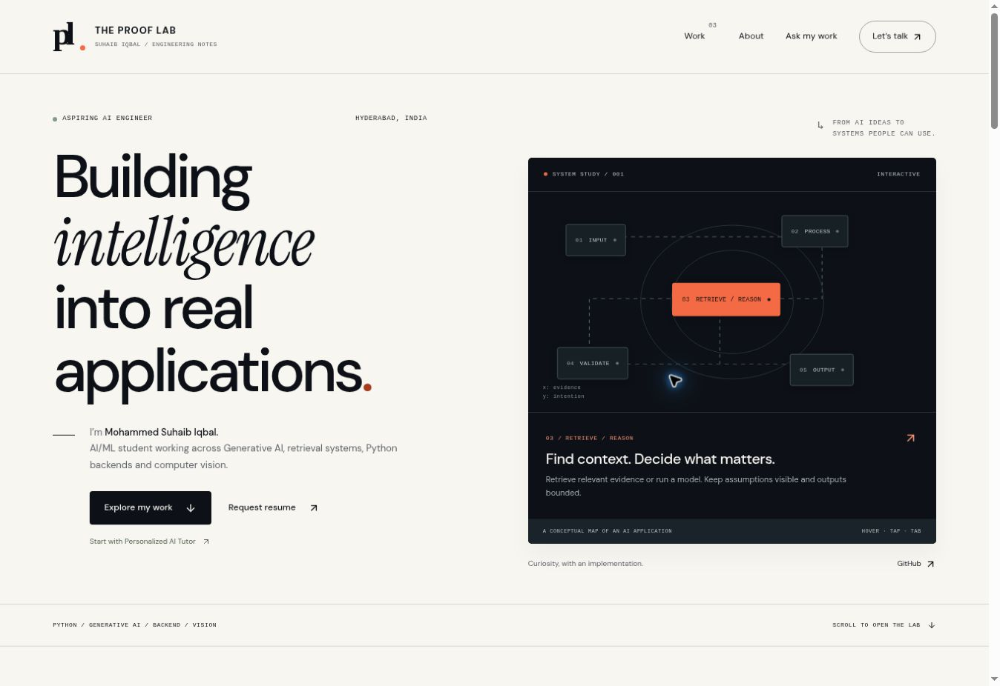

# The Proof Lab



An interactive, source-grounded AI engineering portfolio for **Mohammed Suhaib Iqbal**. Three featured projects, in order: Personalized AI Tutor, SmartClaimAI, Vision-Reality.

## Run

Requires Node.js 22+ and npm. In the GitHub profile repository, run these commands from the `the-proof-lab/` folder.

```bash
npm ci
npm run dev
```

Open http://localhost:3000. No database or API key is required.

```bash
npm run lint
npm run typecheck
npm test
npm run build
```

Next.js App Router, strict TypeScript, React, self-hosted open-source fonts, Lucide icons and custom CSS. A static export provides actual navigable pages and client-side interactions with no backend service dependency.

## What works

- Keyboard, tap and pointer hero lifecycle explorer.
- Three Project X-Ray pages with six accessible views each.
- Clickable architecture components and pinned source-file links.
- Fictional RAG explorer with calculated toy cosine similarity.
- Fictional claim-intake simulator with evidence state and deterministic routing.
- Frame timeline and adjustable detection cadence arithmetic.
- Recruiter, Technical and Deep Dive lenses.
- Ask My Work guided FAQ: approved local content, bounded input, safe unknown answer. **It is not an LLM.** Questions do not leave the browser; there is no provider request, tool execution or arbitrary source retrieval. A server-side rate limiter/timeout is inapplicable to this zero-network fallback. Adding a provider later requires a real server route, abuse controls, provider timeout and bounded context; never add keys to NEXT_PUBLIC variables.
- Email/GitHub contact, SEO metadata, robots, sitemap, original social card and reduced-motion support.

## Content and source

```text
app/                 Server-rendered pages, layout, metadata and global design tokens
components/          Interactive diagrams, X-Ray views, simulations and site chrome
lib/projects.ts      Case-study content and owner profile
lib/evidence.json    Pinned repository revisions and inspected paths
lib/snippets.json    Verbatim source excerpts
lib/simulations.ts   Fictional datasets, deterministic logic and FAQ collection
tests/               Meaningful simulation/grounding regressions
docs/                Evidence matrix, design system, verification and deployment notes
public/              Original vector artwork and favicon
scripts/dev.mjs      Next.js dev launcher compatible with preview host/port arguments
```

Source/code facts are separate from performance claims and personal authorship. SmartClaimAI is adapted from an attributed upstream project; its private repository requires access. Historical 3 October 2026 audit numbers are not fresh test runs. Underlying projects were not deployed or retested by this portfolio build.

## Owner review still required

- Approve one original resume PDF as the canonical public file. Two screenshots were available; neither was selected or published. Until then, **Request resume** is a working mailto alternative.
- Supply the exact LinkedIn URL and credential verification URLs if desired.
- CGPA and phone are not public. Confirm current internship wording and clarify individual contributions when more evidence is available.

## Deploy on Vercel

Import a GitHub repository containing this project, set Root Directory to `the-proof-lab` when importing the profile repository, select Next.js, build command `npm run build`, output `out`. The checked-in vercel.json supplies static security headers. No paid add-ons or runtime secrets are needed.

Set `NEXT_PUBLIC_SITE_URL` to the confirmed production origin **before the production build** so canonical metadata, sitemap and robots share the correct origin. Add the approved resume under public/resume.pdf and set profile.resume in lib/projects.ts once the owner chooses it.

The static export can also be hosted on any static host. Preserve the Sites project ID in .openai/hosting.json when continuing the existing Site.

See docs/QA.md for executed checks and explicit limits. No live deployment is claimed until a hosting provider returns a successful result.
